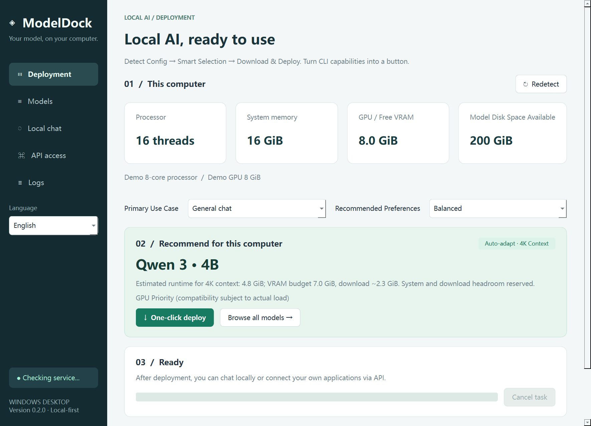

# ModelDock

Companion chat: [ModelDock Chat (MDC)](https://github.com/reaiksp/ModelDock-Chat) — personas, memory, slang and local voice.

[简体中文](README.md) | **English**

ModelDock 0.5.0 is a Windows desktop app for deploying local text models through the Ollama CLI. It detects the user's hardware, recommends a model, downloads it, verifies loading, and provides local API examples.

Development assistance: **OpenAI Codex**. The initial application code and documentation were developed with Codex assistance.

Repository: [ModelDock-Windows](https://github.com/reaiksp/ModelDock-Windows). For personalities, persistent conversations, memory and slang learning, use the independent companion [ModelDock Chat (MDC)](https://github.com/reaiksp/ModelDock-Chat). The two applications use separate repositories and data directories.

## Two requirement sliders (0.5.0)

The **Compressed large model** use case has two five-step sliders. **Dragging only updates recommendations and preferences. Downloads begin when the user clicks the deployment button or a model card's Download and deploy button.** Dragging never changes the active chat model.

| Compression toward full precision | Same Qwen3.8-27B text weights | Download GiB | Estimated 4K runtime GiB |
| --- | --- | ---: | ---: |
| 1 | GSQ-RCO IQ2_XS | 7.9 | 10.0 |
| 2 | GSQ-RCO IQ3_XXS | 9.5 | 11.5 |
| 3 | Q4_K_M | 17.7 | 20.5 |
| 4 | Q8_0 | 26.7 | 30.0 |
| 5 | Full-precision BF16 text weights | 50.2 | 54.0 |

The second slider selects **conversation length and memory requirements**: short/basic 4K, daily/standard 4K, longer/enhanced retrieval 8K, long/detailed summaries 16K, and very long/detail priority 32K. These are requirements, not measured memory accuracy. General chat and coding retain their existing catalogs; the precision slider is disabled for those use cases while the conversation slider remains available.

Recommendations combine both choices with system headroom, available RAM, free VRAM, disk and the selected local speech budget. The highest feasible precision at or below the target is shown, with an explicit fallback explanation. Conversation requirements are never silently shortened. If no same-family model fits, no plan is offered. GPU and RAM are not added together. CPU large models require a deliberate Quality first preference and may generate very slowly.

Sources: [ISTA-DASLab GSQ-RCO](https://huggingface.co/ISTA-DASLab/Qwen3.8-27B-GSQ-RCO-GGUF) and [ggml-org Q4/Q8/BF16](https://huggingface.co/ggml-org/Qwen3.8-27B-GGUF). Exact pinned text GGUF files are downloaded, checked for size and SHA-256, then imported through the Ollama CLI. BF16 means original text precision; Q8 remains quantized. No vision projector or MTP auxiliary files are included. Older IQ2_S/IQ3_S files remain in the manual catalog. File size is not runtime VRAM use; quantization and repeated prompts do not promise lossless quality.

Successful deployment records the target and actual grade, conversation demand, context and speech budget. MDC explicitly imports this plan through Connections → Apply MD deployment plan while preserving personalities, raw input, profile data and API keys. Compressed models can use approved MDC memories and slang, including a combined private default-prompt snapshot. This persists configuration, not trained weights, and still uses context.

See [the dual-slider policy and migration details](docs/DUAL_SLIDERS.md) and [release validation and limits](RELEASE_NOTES.md).

## In-app language switching and user input

Use **Language / 语言** in the sidebar to switch immediately between Simplified Chinese and English. The choice persists across restarts. AI reply language is a separate preference: follow the user's input, Simplified Chinese, or English. An explicit reply preference is included in the request; changing the interface language does not change that preference.

Typed input, personalities, provider/model names and memory records retain their original text. Internal configuration values remain stable across locales. MDC keeps unsent drafts per conversation and includes language-adaptation instructions in context budgeting. The application adapts a copy of the outgoing prompt; stored user messages are not rewritten.



## Quick start

Supported target: Windows 10 22H2 or Windows 11, x64.

1. Extract the entire portable package and run `ModelDock.exe`. Keep the `_internal` directory next to it. Python is not required for the packaged application.
2. Choose general chat, coding or compressed large models, set the speed/quality preference, then adjust both requirement sliders.
3. Click the recommendation/deployment button. If Ollama is missing, ModelDock downloads its official installer and checks the Windows signature before running it.
4. Deployment runs `ollama serve` and `ollama pull <model>`, then checks that the model can load.
5. Use the local chat page or copy an API example into your own application.

The initial runtime and model downloads require internet access and sufficient disk space. Ollama and model weights are not bundled. Cancelled model downloads can be retried; Ollama reuses downloaded parts.

## Recommendations

The catalog includes Qwen 3 general-purpose text models, Qwen 2.5 Coder models, and the separate Qwen3.8-27B GSQ-RCO compressed-model use case. Recommendations account for available system memory, confirmed free NVIDIA VRAM, and free space on the model drive.

System memory reserves at least 3 GiB or 20% of total RAM; VRAM reserves at least 1 GiB or 12%. RAM and VRAM are not simply added together. The first NVIDIA GPU is used to match MDC local speech on CUDA 0. CPU balanced/speed recommendations favor smaller models.

Base estimates assume the listed precision at 4K; 8K/16K/32K add 1.5/4/8 GiB respectively. Fixed GGUF imports reserve 2.15 times download size plus 1 GiB for cache and the Ollama copy; ordinary models reserve 15% plus 1 GiB. Actual requirements vary with model versions, drivers, context and background applications. A recommendation is an estimate; successful loading is the final check. When independent VRAM cannot be confirmed, including some AMD/Intel configurations, the app uses a conservative system-memory estimate. Ollama decides which acceleration is available.

## Local APIs

Default server: `http://127.0.0.1:11434`.

- `GET /api/tags`: installed models.
- `POST /api/chat`: native Ollama chat.
- `POST /v1/chat/completions`: OpenAI-compatible chat.

```python
# pip install openai
from openai import OpenAI

client = OpenAI(base_url="http://127.0.0.1:11434/v1", api_key="ollama")
response = client.chat.completions.create(
    model="qwen3:1.7b",  # Replace with an installed model tag.
    messages=[{"role": "user", "content": "Hello!"}],
    reasoning_effort="none",
)
print(response.choices[0].message.content)
```

The API key above is a placeholder: local Ollama does not authenticate it. Servers started by ModelDock bind to loopback. If an existing Ollama server is reused, its existing network configuration applies. Closing ModelDock cancels its current task but leaves Ollama running for other API clients.

## Storage and troubleshooting

- Preferences and application logs: `%LOCALAPPDATA%\ModelDock`.
- Model files: Ollama's default `~/.ollama/models`, or the process/current-user `OLLAMA_MODELS` environment variable. An already-running Ollama instance uses its own environment; keep these settings consistent.
- In-window chat is held in memory. For persistent chat and memory, use MDC.
- Failed downloads: check network/proxy access and free space, then retry.
- Loading failures: free memory or select a smaller model.
- Unrecognized NVIDIA GPU: check that its driver and `nvidia-smi` work.
- Installer signature failure: install Ollama from its official site, then retry.

## Ollama CLI statement

ModelDock is an independent GUI project that uses the [official Ollama CLI](https://github.com/ollama/ollama) and HTTP APIs. It is not an official Ollama client and is not affiliated with Ollama. Ollama and individual model weights are governed by their respective licenses. See [Ollama for Windows](https://docs.ollama.com/windows), [chat API](https://docs.ollama.com/api/chat), and [Ollama's license](https://github.com/ollama/ollama/blob/main/LICENSE).

## Development and packaging

Use Python 3.12 on Windows x64:

```powershell
python -m venv .venv
.\.venv\Scripts\python.exe -m pip install -r requirements-dev.txt
.\.venv\Scripts\python.exe main.py
.\.venv\Scripts\python.exe -m pytest -q
powershell -ExecutionPolicy Bypass -File .\build.ps1
```

The build produces a portable directory, ZIP and SHA256 file in `dist/`. Dynamic Qt/PySide6 libraries, license notices and application source are included. Keep those files together and preserve the ability to replace compatible LGPL libraries.

This is an unsigned early test build. Clean Windows installation, driver coverage and real download connectivity still require environment-specific acceptance testing. See [release notes](RELEASE_NOTES.md) and [third-party notices](THIRD_PARTY_NOTICES.md).

## Legacy capacity settings and speech compatibility

Existing larger-model (4K) settings migrate to demand level 2; longer-context (16K) settings migrate to level 4. Precision defaults to level 3. Existing plans remain compatible. Switching use cases or interface languages preserves slider values and original user text.

Local 0.6B/1.7B speech reserves 4/7 GiB VRAM and 4/5 GiB RAM respectively. Cloud speech adds no local speech-model reserve. MDC clamps actual context to model metadata. Importing a speech budget does not install or start a speech model. User content and API credentials are preserved. See the [speech cloning and training capability audit](docs/SPEECH_CAPABILITIES.md).
