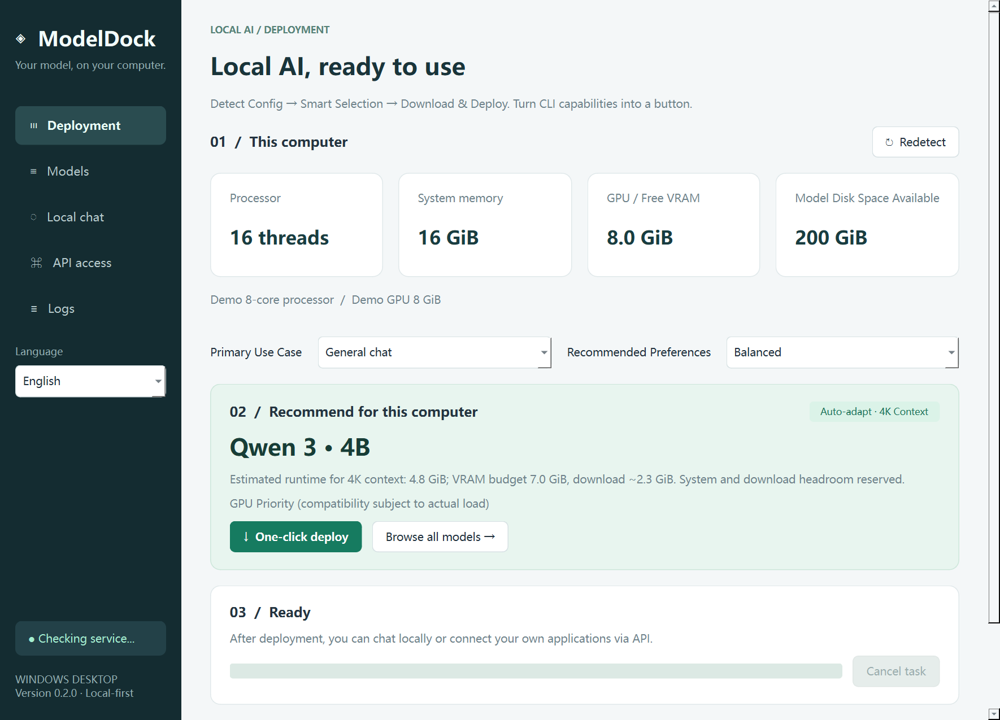

# ModelDock

[简体中文](README.md) | **English**

ModelDock is a Windows desktop app for deploying local text models through the Ollama CLI. It detects the user's hardware, recommends a model, downloads it, verifies loading, and provides local API examples.

Development assistance: **OpenAI Codex**. The initial application code and documentation were developed with Codex assistance.

Repository: [ModelDock-Windows](https://github.com/reaiksp/ModelDock-Windows). For personalities, persistent conversations, memory and slang learning, use the independent companion [ModelDock Chat (MDC)](https://github.com/reaiksp/ModelDock-Chat). The two applications use separate repositories and data directories.

## In-app language switching and user input

Use **Language / 语言** in the sidebar to switch immediately between Simplified Chinese and English. The choice persists across restarts. AI reply language is a separate preference: follow the user's input, Simplified Chinese, or English. An explicit reply preference is included in the request; changing the interface language does not change that preference.

Typed input, personalities, provider/model names and memory records retain their original text. Internal configuration values remain stable across locales. MDC keeps unsent drafts per conversation and includes language-adaptation instructions in context budgeting. The application adapts a copy of the outgoing prompt; stored user messages are not rewritten.



## Quick start

Supported target: Windows 10 22H2 or Windows 11, x64.

1. Extract the entire portable package and run `ModelDock.exe`. Keep the `_internal` directory next to it. Python is not required for the packaged application.
2. Choose general chat or coding, then choose balanced, speed or quality preference.
3. Click the recommendation/deployment button. If Ollama is missing, ModelDock downloads its official installer and checks the Windows signature before running it.
4. Deployment runs `ollama serve` and `ollama pull <model>`, then checks that the model can load.
5. Use the local chat page or copy an API example into your own application.

The initial runtime and model downloads require internet access and sufficient disk space. Ollama and model weights are not bundled. Cancelled model downloads can be retried; Ollama reuses downloaded parts.

## Recommendations

The catalog includes Qwen 3 general-purpose text models and Qwen 2.5 Coder models. Recommendations account for available system memory, confirmed free NVIDIA VRAM, and free space on the model drive.

System memory reserves at least 3 GiB or 20% of total RAM; VRAM reserves at least 1 GiB or 12%. RAM and VRAM are not simply added together. Multiple GPUs are evaluated conservatively using the largest single-card free-memory value. CPU balanced/speed recommendations favor smaller models.

Memory estimates assume default quantization and a 4K context. Actual requirements vary with model versions, drivers, context and background applications. A recommendation is an estimate; successful loading is the final check. When independent VRAM cannot be confirmed, including some AMD/Intel configurations, the app uses a conservative system-memory estimate. Ollama decides which acceleration is available.

## Local APIs

Default server: `http://127.0.0.1:11434`.

- `GET /api/tags`: installed models.
- `POST /api/chat`: native Ollama chat.
- `POST /v1/chat/completions`: OpenAI-compatible chat.

```python
# pip install openai
from openai import OpenAI

client = OpenAI(base_url="http://127.0.0.1:11434/v1", api_key="ollama")
response = client.chat.completions.create(
    model="qwen3:1.7b",  # Replace with an installed model tag.
    messages=[{"role": "user", "content": "Hello!"}],
    reasoning_effort="none",
)
print(response.choices[0].message.content)
```

The API key above is a placeholder: local Ollama does not authenticate it. Servers started by ModelDock bind to loopback. If an existing Ollama server is reused, its existing network configuration applies. Closing ModelDock cancels its current task but leaves Ollama running for other API clients.

## Storage and troubleshooting

- Preferences and application logs: `%LOCALAPPDATA%\ModelDock`.
- Model files: Ollama's default `~/.ollama/models`, or the process/current-user `OLLAMA_MODELS` environment variable. An already-running Ollama instance uses its own environment; keep these settings consistent.
- In-window chat is held in memory. For persistent chat and memory, use MDC.
- Failed downloads: check network/proxy access and free space, then retry.
- Loading failures: free memory or select a smaller model.
- Unrecognized NVIDIA GPU: check that its driver and `nvidia-smi` work.
- Installer signature failure: install Ollama from its official site, then retry.

## Ollama CLI statement

ModelDock is an independent GUI project that uses the [official Ollama CLI](https://github.com/ollama/ollama) and HTTP APIs. It is not an official Ollama client and is not affiliated with Ollama. Ollama and individual model weights are governed by their respective licenses. See [Ollama for Windows](https://docs.ollama.com/windows), [chat API](https://docs.ollama.com/api/chat), and [Ollama's license](https://github.com/ollama/ollama/blob/main/LICENSE).

## Development and packaging

Use Python 3.12 on Windows x64:

```powershell
python -m venv .venv
.\.venv\Scripts\python.exe -m pip install -r requirements-dev.txt
.\.venv\Scripts\python.exe main.py
.\.venv\Scripts\python.exe -m pytest -q
powershell -ExecutionPolicy Bypass -File .\build.ps1
```

The build produces a portable directory, ZIP and SHA256 file in `dist/`. Dynamic Qt/PySide6 libraries, license notices and application source are included. Keep those files together and preserve the ability to replace compatible LGPL libraries.

This is an unsigned early test build. Clean Windows installation, driver coverage and real download connectivity still require environment-specific acceptance testing. See [release notes](RELEASE_NOTES.md) and [third-party notices](THIRD_PARTY_NOTICES.md).
